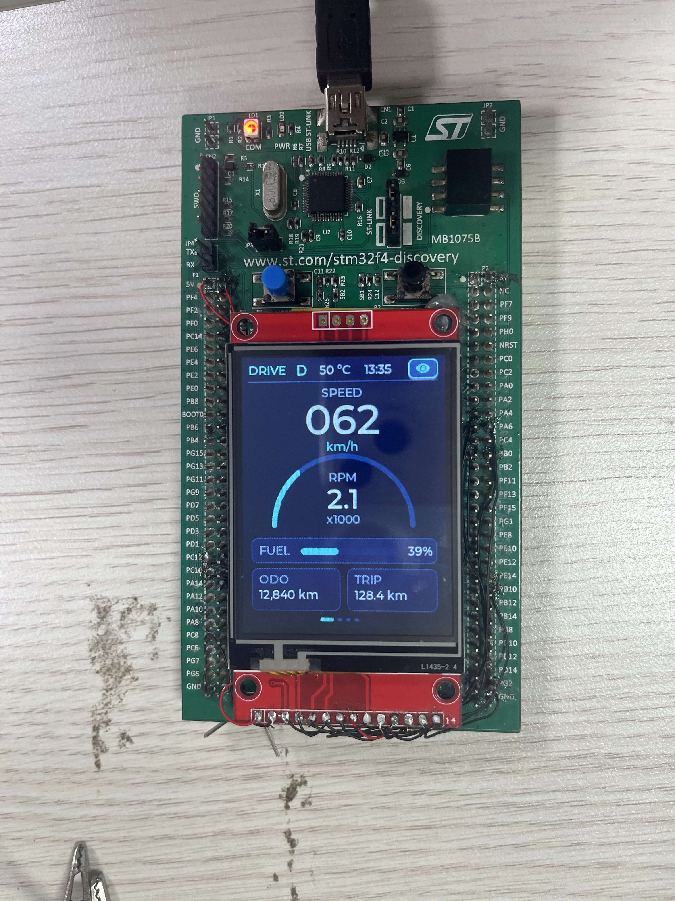
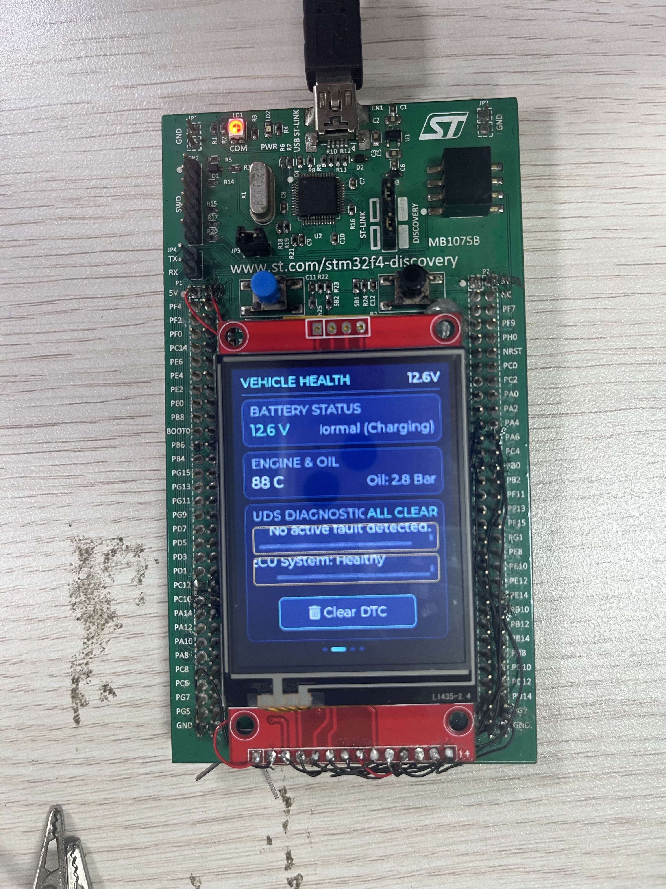
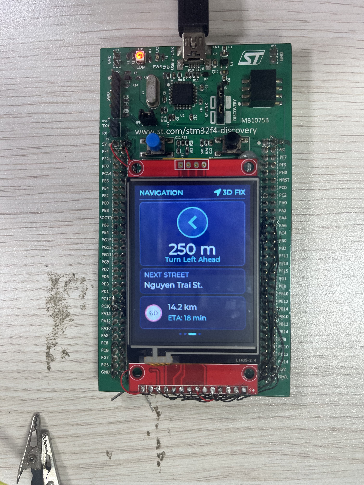
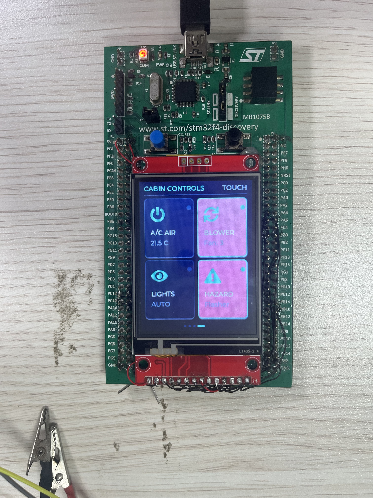
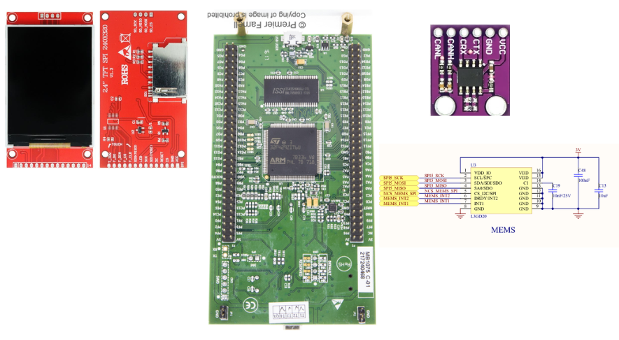
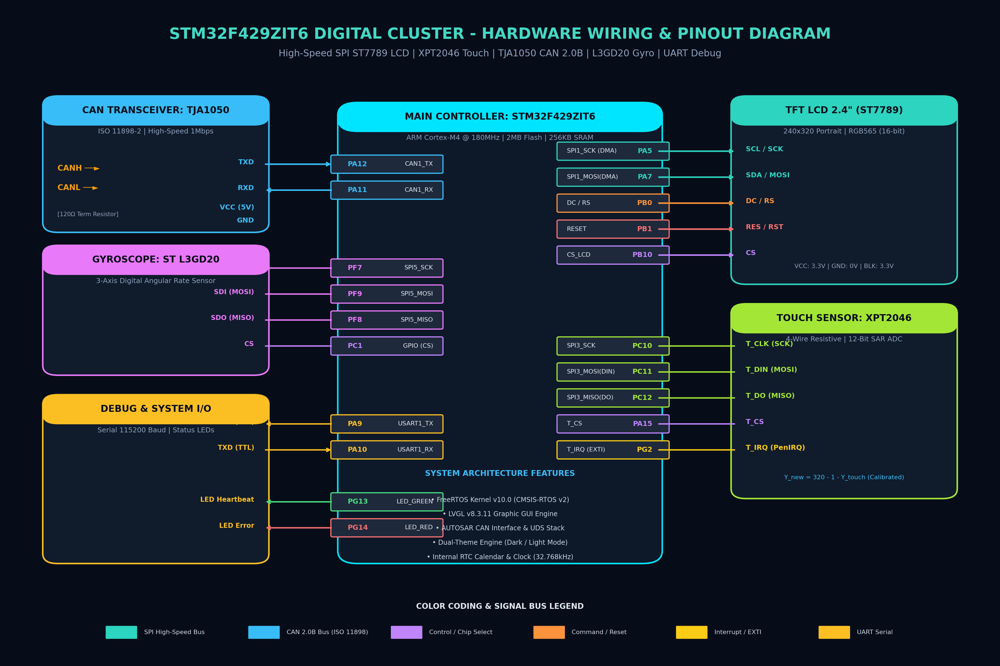
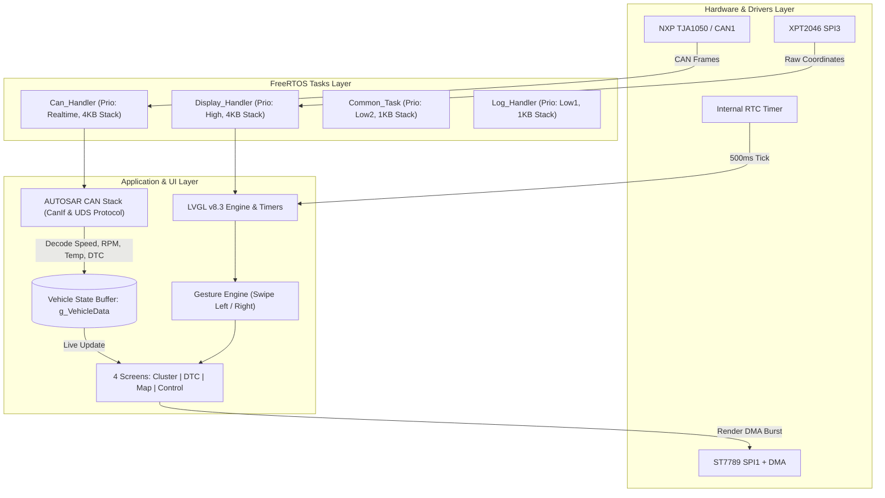

# 🚗 Next-Gen Automotive Digital Instrument Cluster & Cabin HMI

<div align="center">

[](https://www.st.com/en/microcontrollers-microprocessors/stm32f429zi.html)
[](https://www.freertos.org/)
[](https://lvgl.io/)
[](https://www.autosar.org/)
[](https://en.wikipedia.org/wiki/Unified_Diagnostic_Services)
[](LICENSE)

*Hệ thống Cụm Đồng hồ Kỹ thuật số (Digital Cluster) và Giao diện Điều khiển Khoang lái Cảm ứng Đa trang thế hệ mới dành cho xe ô tô thông minh, phát triển trên nền tảng vi điều khiển STM32F429 ARM Cortex-M4, RTOS thời gian thực và kiến trúc mạng CAN chuẩn AUTOSAR.*

---

<!-- PRODUCT BANNER IMAGE PLACEHOLDER -->

*Hình 1: Tổng quan thiết bị Cụm đồng hồ Taplo Kỹ thuật số tích hợp Cảm ứng 2.4 inch Portrait*

</div>

---

## 📌 Mục lục (Table of Contents)
1. [Giới thiệu Sản phẩm (Product Overview)](#-giới-thiệu-sản-phẩm-product-overview)
2. [Các Tính năng Nổi bật (Key Features)](#-các-tính-năng-nổi-bật-key-features)
3. [Thư viện Hình ảnh & Video Demo (Media & Demos)](#-thư-viện-hình-ảnh--video-demo-media--demos)
4. [Chi tiết 4 Màn hình Tương tác (Screen Breakdown)](#-chi-tiết-4-màn-hình-tương-tác-screen-breakdown)
5. [Kiến trúc Phần cứng (Hardware Architecture)](#-kiến-trúc-phần-cứng-hardware-architecture)
6. [Sơ đồ Đấu dây & Kết nối Chân (Pinout & Wiring)](#-sơ-đồ-đấu-dây--kết-nối-chân-pinout--wiring)
7. [Kiến trúc Phần mềm (Software Architecture)](#-kiến-trúc-phần-mềm-software-architecture)
8. [Cấu trúc Thư mục Mã nguồn (Project Structure)](#-cấu-trúc-thư-mục-mã-nguồn-project-structure)
9. [Hướng dẫn Biên dịch & Nạp Code (Build & Flash)](#-hướng-dẫn-biên-dịch--nạp-code-build--flash)
10. [Lộ trình Phát triển (Roadmap)](#-lộ-trình-phát-triển-roadmap)
11. [Tác giả & Bản quyền (License)](#-tác-giả--bản-quyền-license)

---

## 🌟 Giới thiệu Sản phẩm (Product Overview)

**Digital Cluster & Cabin HMI** là một sản phẩm nhúng ô tô hoàn chỉnh, kết hợp giữa khả năng xử lý đồ họa mạnh mẽ của thư viện **LVGL v8.3** và độ ổn định chuẩn công nghiệp xe hơi của **AUTOSAR CAN Communication Stack** cùng giao thức chẩn đoán **UDS (Unified Diagnostic Services - ISO 14229)**.

Sản phẩm được thiết kế trên form-factor đứng (**Portrait 240 x 320 px**), hỗ trợ thao tác vuốt cảm ứng đa chiều mượt mà giữa **4 phân hệ màn hình khép kín**, mang đến trải nghiệm buồng lái thông minh (*Smart Cockpit*) hiện đại tương tự các mẫu xe cao cấp.

---

## ✨ Các Tính năng Nổi bật (Key Features)

- 🔄 **Cử chỉ Vuốt Xoay vòng Khép kín (Circular Swipe Gestures):** Vuốt sang trái để tiến trang ($1 \rightarrow 2 \rightarrow 3 \rightarrow 4 \rightarrow 1$), vuốt sang phải để lùi trang ($1 \leftarrow 2 \leftarrow 3 \leftarrow 4 \leftarrow 1$) với hiệu ứng trượt màn hình mượt mà (Slide Transition 280ms).
- 🚗 **AUTOSAR CAN Communication:** Tương thích chuẩn AUTOSAR (MCAL `Can`, ECU Abstraction `CanIf`, PDU Router), giải mã dữ liệu vận tốc, vòng tua, lượng xăng, nhiệt độ từ bus CAN 2.0B thời gian thực (500 kbps).
- 🛠️ **UDS Diagnostics (ISO 14229):** Tích hợp phân hệ hiển thị và xóa mã lỗi chẩn đoán (DTC - Diagnostic Trouble Codes) trực tiếp bằng nút bấm cảm ứng trên màn hình.
- 🎨 **Bộ chuyển Theme Thông minh (Dual Theme Engine):** Chuyển đổi linh hoạt giữa giao diện Thể thao Tối (**Dark Theme**) và Hiện đại Sáng (**Light Theme**) chỉ với một chạm.
- 🔘 **Nút bấm Cảm ứng Phản hồi Xúc giác (Tactile Tactile Buttons):** 4 nút điều khiển tải cabin (A/C, Quạt gió, Đèn xe, Hazard) với hiệu ứng co lõm vật lý khi chạm, transition mượt mà và đèn LED trạng thái ON/OFF phát sáng neon.
- ⚡ **Khử nhiễu Cảm ứng & Hiệu chuẩn Toạ độ Chính xác:** Driver cảm ứng điện trở XPT2046 được lọc nhiễu median/average, lật trục toán học $Y_{lvgl} = 320 - 1 - Y_{touch}$ chống lệch tọa độ tuyệt đối.
- 🕒 **Đồng bộ RTC & Cảm biến Góc nghiêng (IMU):** Tích hợp chip con quay hồi chuyển ST L3GD20 (SPI) và thời gian thực RTC nội với độ trễ thấp.

---

## 📸 Thư viện Hình ảnh & Video Demo (Media & Demos)

### 1. Video Trải nghiệm Thực tế (Demo Video)
<!-- CHÈN VIDEO DEMO TẠI ĐÂY -->
[](docs/videos/demo.mp4)
*Nhấp vào hình trên hoặc truy cập [docs/videos/demo.mp4](docs/videos/demo.mp4) để xem video thao tác vuốt chạm và chạy thực tế.*

---

### 2. Bộ ảnh 4 Màn hình Tương tác (Screen Showcase)

| Màn 1: Taplo Vận hành Chính | Màn 2: Sức khỏe Xe & Lỗi UDS DTC |
|:---:|:---:|
|  |  |
| *Đồng hồ tốc độ lớn, Arc RPM bán nguyệt, Fuel Bar, ODO/Trip, nút đổi Theme* | *Điện áp bình 12.6V, Nhiệt độ động cơ, Danh sách DTC & nút Clear DTC* |

| Màn 3: Mini Navigation & Bản đồ | Màn 4: Bảng Điều khiển Cabin |
|:---:|:---:|
|  |  |
| *Mũi tên chỉ đường lớn (Turn Left), Biển báo tốc độ 60, ETA & cự ly* | *4 nút bấm cảm ứng lớn A/C, Quạt gió, Đèn xe, Đèn khẩn cấp có LED báo* |

---

## 🖥️ Chi tiết 4 Màn hình Tương tác (Screen Breakdown)

```
       [Vuốt Trái ◄]                    [Vuốt Trái ◄]                    [Vuốt Trái ◄]
 [ Màn 1: TAPLO CHÍNH ]   ═══════════>   [ Màn 2: VEHICLE & DTC ]  ═══════════>   [ Màn 3: NAVIGATION ]
   (Speed, RPM, Fuel)                       (Battery, Temp, DTCs)                     (Arrow, Next Street)
           ▲                                                                                   │
           │                                                                                   │
     [Vuốt Trái ◄]                                                                       [Vuốt Trái ◄]
           │                                                                                   ▼
           └──────────────────────────── [ Màn 4: CABIN CONTROL ] <────────────────────────────┘
                                           (A/C, Fan, Lights, Hazard)
```

### 1. Màn hình 1: Taplo Vận hành Kỹ thuật số (`SCREEN_ID_MAIN`)
- **Đồng hồ Tốc độ (Speedometer):** Số điện tử lớn ở trung tâm (Font Montserrat 48), đơn vị km/h, cập nhật trực tiếp từ bus CAN.
- **Vòng tua máy (Tachometer Arc):** Vòm cung bán nguyệt ($180^\circ$) đường kính $170$ px, đồng tâm tuyệt đối với cụm nhãn `"RPM"`, `"2.4"`, `"x1000"` tại tâm màn hình ($X = 120$).
- **Thanh Nhiên liệu (Fuel Bar):** Bar đo phần trăm xăng (0 - 100%) kèm nhãn % số thực tế.
- **Thẻ Hành trình (Trip Computer):** Cụm thẻ đối xứng hiển thị ODO (Tổng quãng đường) và TRIP (Hành trình ngắn).
- **Thanh trạng thái trên cùng:** Chế độ lái `DRIVE`, vị trí cần số `D` (xanh ngọc), nhiệt độ môi trường, đồng hồ thời gian thực RTC.
- **Nút đổi Theme (Theme Switcher):** Nút cảm ứng nhỏ ở góc trên phải để đổi sang Light/Dark mode.

### 2. Màn hình 2: Sức khỏe Xe & Mã lỗi UDS DTC (`SCREEN_ID_VEHICLE_DTC`)
- **Điện áp Ắc quy (Battery Status):** Hiển thị điện áp bình (12.6V) kèm trạng thái sạc (Normal/Charging).
- **Nhiệt độ Nước làm mát & Áp suất nhớt:** Giám sát thời gian thực nhiệt độ động cơ ($88^\circ\text{C}$) và áp suất nhớt (2.8 Bar).
- **Phân hệ Chẩn đoán UDS DTC (Diagnostic Trouble Codes):**
  - Badge cảnh báo màu cam: `2 FAULTS FOUND`.
  - Danh sách mã lỗi chuẩn OBD-II / UDS: `P0100: MAF Circuit`, `P0113: IAT High In`.
  - **Nút bấm cảm ứng Clear DTC:** Gửi tín hiệu xóa mã lỗi và tự động đổi trạng thái sang `ALL CLEAR` (Xanh lá).

### 3. Màn hình 3: Mini Navigation & Chỉ đường (`SCREEN_ID_MAP`)
- **Mũi tên Chỉ đường Lớn (Turn-by-Turn Indicator):** Khung tròn nổi bật với mũi tên rẽ lớn (`LV_SYMBOL_LEFT`), cự ly hành động (`250 m`) và hành động kế tiếp (`Turn Left Ahead`).
- **Tên Tuyến đường sắp tới:** Thẻ thông tin đường phố kế tiếp (`Nguyen Trai St. - Ha Noi, VN`).
- **Dự tính Hành trình (ETA) & Khoảng cách:** Quãng đường còn lại (`14.2 km`), thời gian dự kiến đến (`18 min`).
- **Biển báo Giới hạn Tốc độ (Speed Limit):** Biển báo tròn viền đỏ chuẩn giao thông quốc tế giới hạn `[60]`.

### 4. Màn hình 4: Bảng Điều khiển Cảm ứng Khoang lái (`SCREEN_ID_CONTROL`)
- Thiết kế dạng lưới $2 \times 2$ với 4 nút bấm diện tích lớn ($106 \times 126$ px), dễ thao tác khi lái xe:
  1. ❄️ **A/C AIR:** Bật/tắt hệ thống điều hòa nhiệt độ cabin ($21.5^\circ\text{C}$).
  2. 🌀 **BLOWER FAN:** Nấc tốc độ quạt gió (Fan Speed Level 3).
  3. 💡 **HEADLIGHTS:** Đèn chiếu sáng thông minh (AUTO / ON / OFF).
  4. ⚠️ **HAZARD:** Đèn cảnh báo khẩn cấp chớp nháy hai bên.
- **Cơ chế Animation:** Phản hồi lún nút vật lý khi chạm, đổi màu nền mượt mà và tích hợp đèn LED chỉ báo trạng thái phát sáng.

---

## 🔩 Kiến trúc Phần cứng (Hardware Architecture)

<!-- SƠ ĐỒ KHỐI PHẦN CỨNG PLACEHOLDER -->

*Hình 2: Sơ đồ khối kiến trúc phần cứng hệ thống*

### Thông số Kỹ thuật Phần cứng (Hardware Specs)

| Thành phần | Linh kiện / Module | Giao tiếp | Thông số chi tiết |
| :--- | :--- | :---: | :--- |
| **Vi điều khiển (MCU)** | **STM32F429ZIT6** | Core | ARM Cortex-M4 @ 180 MHz, DSP, FPU, 2MB Flash, 256KB SRAM |
| **Màn hình hiển thị** | **TFT LCD 2.4 inch (ST7789)** | SPI1 + DMA | Độ phân giải $240 \times 320$ (Portrait), màu RGB565 (16-bit) |
| **Bộ điều khiển Cảm ứng** | **XPT2046 (HR2046)** | SPI3 | Cảm ứng điện trở 12-bit ADC, ngắt PenIRQ phát hiện chạm |
| **CAN Transceiver** | **NXP TJA1050** | CAN1 | Chuẩn CAN 2.0B tốc độ cao lên tới 1 Mbps, bảo vệ ESD |
| **Cảm biến Góc nghiêng** | **ST L3GD20** | SPI5 | Con quay hồi chuyển kỹ thuật số 3 trục (Gyroscope) |
| **Thời gian thực** | **Internal RTC** | Internal | Đồng hồ lịch, giờ, phút, giây kèm thanh ghi lưu trữ Backup |
| **Nạp & Gỡ lỗi** | **ST-LINK V2 / SWD** | SWD | Hỗ trợ gỡ lỗi trực tiếp qua SWD và cổng Serial UART1 Debug |

---

## 🔌 Sơ đồ Đấu dây & Kết nối Chân (Pinout & Wiring)

<!-- ẢNH ĐẤU NỐI THỰC TẾ PLACEHOLDER -->

*Hình 3: Sơ đồ kết nối chân giữa STM32F429 và các ngoại vi*

### Bảng Kết nối Chi tiết (Pin Mapping Table)

| Module Ngoại vi | Chân Module | Chân STM32F429 | Chức năng Ngoại vi | Ghi chú |
| :--- | :--- | :--- | :--- | :--- |
| **Màn hình ST7789** | VCC | 3.3V / 5V | Nguồn cấp màn hình | |
| | GND | GND | Nối mass chung | |
| | SCL / SCK | **PA5** | SPI1_SCK | Tốc độ cao 45 MHz |
| | SDA / MOSI | **PA7** | SPI1_MOSI | Truyền dữ liệu DMA Burst |
| | RES / RST | **PB1** | GPIO Output | Reset màn hình |
| | DC / RS | **PB0** | GPIO Output | Lệnh (Command) / Dữ liệu (Data) |
| | CS | **PB10** | GPIO Output | Chip Select ST7789 |
| | BLK / LED | 3.3V / PWM | Đèn nền màn hình | Sáng liên tục hoặc điều chỉnh PWM |
| **Cảm ứng XPT2046** | T_CLK | **PC10** | SPI3_SCK | Xung clock đọc cảm ứng |
| | T_CS | **PA15** | GPIO Output | Chip Select cảm ứng |
| | T_DIN (MOSI)| **PC11** | SPI3_MOSI | Gửi lệnh đọc kênh X/Y/Z |
| | T_DO (MISO) | **PC12** | SPI3_MISO | Nhận dữ liệu toạ độ 12-bit |
| | T_IRQ | **PG2** | GPIO Input / EXTI | Ngắt phát hiện chạm màn hình |
| **CAN Bus TJA1050** | CAN_TX | **PA12** | CAN1_TX | Truyền dữ liệu ra CAN Bus |
| | CAN_RX | **PA11** | CAN1_RX | Nhận dữ liệu CAN Bus (Interrupt) |
| | VCC | 5V | Nguồn cấp Transceiver | Bắt buộc 5V để chuẩn mức logic CAN |
| | GND | GND | Nối mass chung | |
| **Gyroscope L3GD20**| SCK | **PF7** | SPI5_SCK | Đọc dữ liệu con quay |
| | MISO | **PF8** | SPI5_MISO | Nhận dữ liệu góc nghiêng |
| | MOSI | **PF9** | SPI5_MOSI | Gửi lệnh cấu hình cảm biến |
| | CS | **PC1** | GPIO Output | Chip Select L3GD20 |
| **Debug UART** | TX | **PA9** | USART1_TX | In log debug ra máy tính (115200 baud) |
| | RX | **PA10** | USART1_RX | Nhận lệnh điều khiển từ PC |

---

## 💻 Kiến trúc Phần mềm (Software Architecture)

### 1. Phân chia Tác vụ Đa nhiệm FreeRTOS (Multitasking Architecture)



### 2. Chi tiết các Tác vụ FreeRTOS (Task Priority & Allocation)

| Task Name | Hàm Thực thi | Mức Ưu tiên (Priority) | Dung lượng Stack | Chức năng chính |
| :--- | :--- | :---: | :---: | :--- |
| `cantask` | `Can_Handler` | `osPriorityRealtime` | 4096 Bytes | Nhận ngắt CAN, thực thi chu trình AUTOSAR `Can_MainFunction_Read/Write`, giải mã PDU vào `g_VehicleData`. |
| `displaytask` | `Display_Handler` | `osPriorityHigh` | 4096 Bytes | Khởi tạo phần cứng màn hình, cảm ứng, quản lý timer đồ họa LVGL `lv_timer_handler()` và nạp dữ liệu CAN lên widget. |
| `commontask` | `Common_Task` | `osPriorityLow2` | 1024 Bytes | Đọc cảm biến nhiệt độ bổ sung, tính toán hành trình và trạng thái hệ thống. |
| `logtask` | `Log_Handler` | `osPriorityLow1` | 1024 Bytes | In log trạng thái an toàn qua UART không ảnh hưởng đến luồng đồ họa. |

---

## 📁 Cấu trúc Thư mục Mã nguồn (Project Structure)

```bash
digital-cluster/
├── Core/
│   ├── App/                            # Các Task ứng dụng FreeRTOS
│   │   ├── can_task.c / .h             # Luồng xử lý AUTOSAR CAN & PDU Table
│   │   ├── display_task.c / .h         # Luồng hiển thị đồ họa & Khởi tạo LCD
│   │   ├── common_task.c / .h          # Luồng xử lý logic chung
│   │   └── log_task.c / .h             # Luồng in log UART
│   ├── Device_Driver/                  # Tầng Driver thiết bị ngoại vi
│   │   ├── CAN_TJA1050/                # Bộ thư viện chuẩn AUTOSAR CAN Stack
│   │   │   ├── Can/                    # MCAL CAN Driver
│   │   │   ├── CanIf/                  # CAN Interface & Router
│   │   │   └── UDS_Protocol/           # Chuẩn chẩn đoán xe UDS ISO 14229
│   │   ├── ST7789/                     # Driver LCD ST7789 SPI + DMA
│   │   ├── XPT2046/                    # Driver đọc & hiệu chuẩn cảm ứng XPT2046
│   │   ├── L3GD20/                     # Driver Gyroscope 3 trục SPI
│   │   ├── RTC/                        # Driver RTC thời gian thực
│   │   ├── lvgl_port_disp.c / .h       # Giao tiếp Buffer vẽ giữa LVGL và ST7789
│   │   └── TouchController.c / .h      # Giao tiếp con trỏ cảm ứng InDev với LVGL
│   ├── Inc/                            # Headers cấu hình FreeRTOS, LVGL, HAL
│   └── Src/                            # Khởi tạo Main, DMA, Clock STM32
├── Digital_Cluster/
│   └── src/ui/                         # Tầng Giao diện người dùng (LVGL Screens)
│       ├── screens.c / .h              # Định nghĩa và tạo 4 màn hình tương tác
│       ├── ui.c / .h                   # Quản lý chuyển trang, hiệu ứng và vòng lặp
│       └── fonts.h                     # Cấu hình font chữ Montserrat
├── Middlewares/
│   ├── Third_Party/FreeRTOS/           # Nhân FreeRTOS Kernel
│   └── Third_Party/lvgl/               # Thư viện đồ họa LVGL v8.3.11
├── docs/                               # Tài liệu, hình ảnh & video demo
│   ├── images/                         # Thư mục chứa hình ảnh sản phẩm & sơ đồ
│   └── videos/                         # Thư mục chứa video demo
└── README.md                           # Tài liệu tổng quan sản phẩm
```

---

## 🚀 Hướng dẫn Biên dịch & Nạp Code (Build & Flash)

### Yêu cầu Tiền đề (Prerequisites)
1. **Phần mềm:**
   - [STM32CubeIDE](https://www.st.com/en/development-tools/stm32cubeide.html) (khuyên dùng phiên bản $\ge 1.14.0$).
   - ST-Link Server / STM32CubeProgrammer.
2. **Phần cứng:**
   - Bo mạch STM32F429ZIT6 (STM32F429 Discovery hoặc custom board).
   - Module màn hình 2.4 inch TFT LCD ST7789 kèm cảm ứng XPT2046.
   - Module CAN Transceiver TJA1050 (đấu vào CAN bus xe hoặc USB-CAN Analyzer để giả lập).
   - Mạch nạp ST-LINK V2 / V3.

### Các Bước Thực hiện

1. **Clone repository về máy:**
   ```bash
   git clone https://github.com/<your-username>/digital-cluster.git
   cd digital-cluster
   ```

2. **Mở dự án trong STM32CubeIDE:**
   - Chọn `File` $\rightarrow$ `Open Projects from File System...`
   - Chọn thư mục `digital-cluster/Digital_Cluster`.

3. **Biên dịch Dự án (Build):**
   - Nhấn phím tắt `Ctrl + B` (hoặc nhấn nút búa **Build** trên thanh công cụ).
   - Kiểm tra tab Console đảm bảo quá trình biên dịch hoàn thành không có lỗi:
     ```text
     Finished building target: Digital_Cluster.elf
     text: 145280, data: 1240, bss: 75200 --> Build Complete (0 Errors, 0 Warnings)
     ```

4. **Nạp Firmware vào Vi điều khiển (Flash & Debug):**
   - Kết nối mạch ST-LINK với cổng SWD trên bo mạch.
   - Nhấn nút **Run** (phím tắt `Ctrl + F11`) hoặc **Debug** (`F11`).

5. **Mở cổng Serial Debug:**
   - Kết nối chân PA9 (TX) với module USB-to-TTL, mở terminal (Putty / TeraTerm / Hercules) với thông số:
     - **Baudrate:** `115200`
     - **Data bits:** `8`, **Parity:** `None`, **Stop bits:** `1`
   - Quan sát log khởi tạo hệ thống và tọa độ khi chạm màn hình:
     ```text
     Display_Handler: Starting hardware init...
     AUTOSAR CAN Stack Initialized & Started!
     Task Display is Raise! Screens generated successfully.
     LVGL Touch -> X: 120, Y: 160
     ```

---

## 🗺️ Lộ trình Phát triển (Roadmap)

- [x] Thiết kế hoàn chỉnh 4 màn hình độ phân giải đứng $240 \times 320$ px.
- [x] Tích hợp cử chỉ vuốt chuyển màn hình xoay vòng khép kín (Circular Swipe Navigation).
- [x] Lọc nhiễu cảm ứng điện trở và hiệu chuẩn tọa độ $X/Y$ chuẩn xác cho XPT2046.
- [x] Nút đổi giao diện Dark / Light Theme tức thì trên màn hình chính.
- [x] Hiệu ứng lún nút vật lý (Tactile Animation) và LED trạng thái cho cụm phím điều khiển.
- [ ] **Giai đoạn tiếp theo:**
  - [ ] Đóng gói và phát bản tin CAN Transmit khi bấm các nút A/C, Blower, Lights sang hộp BCM thực tế.
  - [ ] Lưu trạng thái Theme và các thông số Trip ODO vào thanh ghi `RTC_BKP_DR0` (Backup Domain) để không bị mất khi ngắt nguồn.
  - [ ] Kết nối dịch vụ UDS Service `0x19` để quét và nạp động toàn bộ mã lỗi DTC của xe lên Màn 2.

---

## 📜 Tác giả & Bản quyền (License)

Dự án được phân phối dưới giấy phép **MIT License**. Bạn hoàn toàn có thể tự do sử dụng, chỉnh sửa và ứng dụng vào các dự án nghiên cứu hoặc thương mại.

---

<div align="center">
  <sub>Được phát triển với niềm đam mê dành cho Hệ thống Nhúng Xe hơi Thông minh (Automotive Embedded Systems).</sub>
</div>

